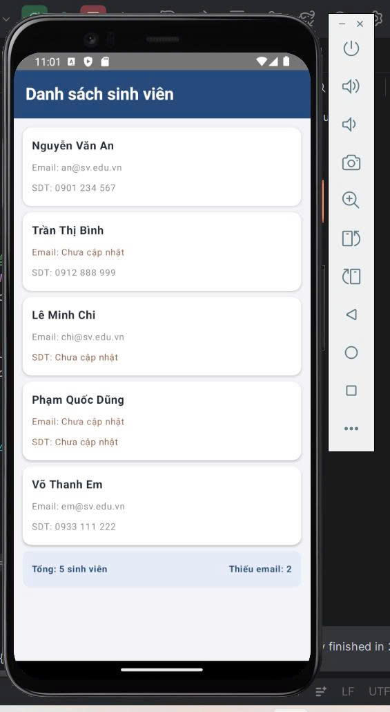

# Source Code – Bài tập 1: Vòng lặp for và kiểu nullable
## 1. Tổng quan mã nguồn
Mã nguồn chính của ứng dụng nằm trong file `MainActivity.kt`. Chương trình sử dụng Kotlin và Jetpack Compose để khai báo dữ liệu sinh viên, xử lý thông tin bị thiếu và xây dựng giao diện danh sách sinh viên.
## 2. Khai báo lớp Student
```kotlin
data class Student(
    val name: String,
    val email: String?,
    val phone: String?
)
```
**Trong đó:**

- `data class Student`: khai báo lớp dữ liệu dùng để lưu thông tin sinh viên.
- `name: String`: họ tên sinh viên, không cho phép nhận giá trị `null`.
- `email: String?`: email có thể là một chuỗi hoặc `null`.
- `phone: String?`: số điện thoại có thể là một chuỗi hoặc `null`.
- `val`: khai báo thuộc tính chỉ đọc sau khi đối tượng được khởi tạo.

Việc sử dụng `String?` cho phép chương trình biểu diễn trường hợp sinh viên chưa cung cấp email hoặc số điện thoại.
## 3. Khởi tạo danh sách sinh viên
```kotlin
val students = listOf(
    Student("Nguyễn Văn An", "an@sv.edu.vn", "0901 234 567"),
    Student("Trần Thị Bình", null, "0912 888 999"),
    Student("Lê Minh Chi", "chi@sv.edu.vn", null),
    Student("Phạm Quốc Dũng", null, null),
    Student("Võ Thanh Em", "em@sv.edu.vn", "0933 111 222")
)
```
Danh sách gồm 5 sinh viên với các trường hợp dữ liệu khác nhau:

- Sinh viên có đầy đủ thông tin.
- Sinh viên thiếu email.
- Sinh viên thiếu số điện thoại.
- Sinh viên thiếu cả email và số điện thoại.

Giá trị `null` được sử dụng để mô phỏng thông tin chưa được cập nhật.
## 4. Đếm số sinh viên thiếu email

```kotlin
var missingEmail = 0

for (student in students) {
    if (student.email == null) {
        missingEmail++
    }
}
```

**Trong đó:**

1. Khởi tạo `missingEmail = 0` để lưu số sinh viên thiếu email.
2. Vòng lặp `for` duyệt lần lượt từng đối tượng `Student` trong danh sách.
3. Điều kiện `student.email == null` kiểm tra email có bị thiếu hay không.
4. Nếu email là `null`, biến `missingEmail` tăng thêm 1.

Với dữ liệu mẫu, sinh viên Trần Thị Bình và Phạm Quốc Dũng không có email, vì vậy kết quả là `missingEmail = 2`.
## 5. Hiển thị dữ liệu nullable
```kotlin
Text(
    text = "Email: ${student.email ?: "Chưa cập nhật"}"
)
```
Kotlin sử dụng **toán tử Elvis `?:`** để cung cấp giá trị thay thế khi biểu thức bên trái là `null`.

- Nếu `student.email` có dữ liệu, chương trình hiển thị email đó.
- Nếu `student.email` bằng `null`, chương trình hiển thị `"Chưa cập nhật"`.
Tương tự, số điện thoại được xử lý bằng biểu thức:

```kotlin
student.phone ?: "Chưa cập nhật"
```
## 6. Tạo danh sách thẻ sinh viên bằng vòng lặp for
```kotlin
for (student in students) {
    StudentCard(student)
    Spacer(modifier = Modifier.height(8.dp))
}
```
Vòng lặp duyệt qua danh sách sinh viên để tạo một giao diện `StudentCard` cho từng người.

Hàm `StudentCard(student)` nhận đối tượng sinh viên và hiển thị:

- Họ tên sinh viên.
- Email hoặc thông báo "Chưa cập nhật".
- Số điện thoại hoặc thông báo "Chưa cập nhật".

`Spacer` tạo khoảng cách giữa các thẻ để giao diện dễ đọc hơn.
## 7. Hiển thị thống kê
```kotlin
Text(text = "Tổng: ${students.size} sinh viên")
Text(text = "Thiếu email: $missingEmail")
```
- `students.size` trả về số lượng phần tử trong danh sách, bằng 5.
- `missingEmail` chứa số sinh viên thiếu email, bằng 2.

Hai giá trị được hiển thị ở cuối danh sách để người dùng dễ dàng theo dõi.
## 8. Kết quả mong đợi
Sau khi chạy ứng dụng, màn hình hiển thị 5 thẻ sinh viên theo đúng thứ tự dữ liệu đã khai báo.
Các trường bị thiếu được thay bằng "Chưa cập nhật". Phần thống kê cuối màn hình hiển thị:

- Tổng: 5 sinh viên.
- Thiếu email: 2.

**Ảnh chụp kết quả:** 


