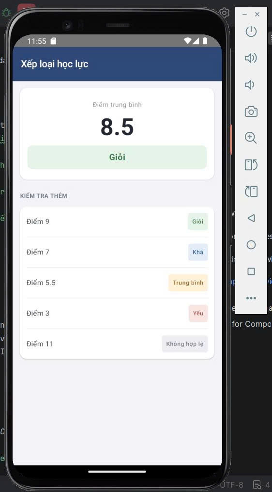

# Source Code – Bài tập 2: Câu lệnh if / else - Tuần 2
## 1. Tổng quan chương trình
Chương trình xây dựng ứng dụng Android phân loại học lực dựa trên điểm số đầu vào.
Các chức năng chính:
- Phân loại điểm thành Giỏi, Khá, Trung bình, Yếu hoặc Không hợp lệ.
- Kiểm tra các mức điểm mẫu.
- Lựa chọn màu sắc theo kết quả phân loại.
- Hiển thị kết quả bằng giao diện Jetpack Compose.
File mã nguồn chính: `MainActivity.kt`.
## 2. Khai báo hàm phân loại học lực
```kotlin
fun xepLoaiHocLuc(diem: Double): String {
    return if (diem < 0 || diem > 10) {
        "Không hợp lệ"
    } else if (diem >= 8.0) {
        "Giỏi"
    } else if (diem >= 6.5) {
        "Khá"
    } else if (diem >= 5.0) {
        "Trung bình"
    } else {
        "Yếu"
    }
}
```
### Trong đó:

- `fun`: từ khóa khai báo hàm trong Kotlin.
- `xepLoaiHocLuc`: tên hàm thực hiện phân loại học lực.
- `diem: Double`: tham số nhận điểm số, cho phép sử dụng số thập phân.
- `String`: kiểu dữ liệu trả về của hàm.
Chương trình sử dụng chuỗi điều kiện `if / else if / else` để kiểm tra điểm theo thứ tự:
1. Nếu điểm nhỏ hơn 0 hoặc lớn hơn 10, trả về `"Không hợp lệ"`.
2. Nếu điểm từ 8.0 trở lên, trả về `"Giỏi"`.
3. Nếu điểm từ 6.5 trở lên, trả về `"Khá"`.
4. Nếu điểm từ 5.0 trở lên, trả về `"Trung bình"`.
5. Các trường hợp còn lại được xếp loại `"Yếu"`.

Điều kiện được kiểm tra lần lượt từ trên xuống dưới. Khi một điều kiện đúng, chương trình trả về kết quả tương ứng và không kiểm tra các nhánh phía sau.

## 3. Xây dựng hàm chọn màu xếp loại
```kotlin
fun mauXepLoai(xepLoai: String): Color {
    return if (xepLoai == "Giỏi") {
        Color(0xFFE5F3E8)
    } else if (xepLoai == "Khá") {
        Color(0xFFE3EDF9)
    } else if (xepLoai == "Trung bình") {
        Color(0xFFFFF0D8)
    } else if (xepLoai == "Yếu") {
        Color(0xFFF9E5E2)
    } else {
        Color(0xFFECEEF2)
    }
}
```
Hàm `mauXepLoai()` nhận tên xếp loại và trả về màu nền tương ứng:
- Giỏi: xanh lá nhạt.
- Khá: xanh dương nhạt.
- Trung bình: vàng nhạt.
- Yếu: đỏ nhạt.
- Không hợp lệ: xám nhạt.
Hàm `mauChuXepLoai()` cũng sử dụng các điều kiện `if / else if / else` để lựa chọn màu chữ tương ứng, giúp người dùng dễ nhận biết kết quả.
## 4. Khai báo điểm và danh sách kiểm tra
```kotlin
val diem = 8.5
val xepLoai = xepLoaiHocLuc(diem)
val danhSachDiem = listOf(
    9.0, 7.0, 5.5, 3.0, 11.0
)
```
- `diem` lưu điểm chính của bài tập, bằng `8.5`.
- `xepLoai` nhận kết quả trả về từ hàm `xepLoaiHocLuc()`.
- `danhSachDiem` chứa năm điểm dùng để kiểm tra thêm.

Việc sử dụng danh sách điểm giúp chương trình kiểm thử nhiều trường hợp mà không cần viết lại điều kiện phân loại cho từng điểm.

## 5. Hiển thị điểm và kết quả chính
```kotlin
Text(
    text = diem.toString(),
    fontSize = 44.sp,
    fontWeight = FontWeight.Bold
)
```
Thành phần `Text` hiển thị điểm chính với kích thước chữ lớn và in đậm. Kết quả xếp loại được hiển thị bằng một thành phần `Text` khác:
```kotlin
Text(
    text = xepLoai,
    modifier = Modifier
        .fillMaxWidth()
        .background(
            color = mauXepLoai(xepLoai),
            shape = RoundedCornerShape(9.dp)
        )
        .padding(vertical = 10.dp),
    color = mauChuXepLoai(xepLoai)
)
```
Trong đó:
- `text = xepLoai`: hiển thị kết quả phân loại.
- `mauXepLoai(xepLoai)`: chọn màu nền theo kết quả.
- `mauChuXepLoai(xepLoai)`: chọn màu chữ theo kết quả.
- `RoundedCornerShape`: tạo góc bo tròn cho nền.
Nhờ vậy, màu sắc thay đổi tự động theo điểm số và kết quả phân loại.
## 6. Duyệt danh sách điểm bằng vòng lặp
```kotlin
for (i in danhSachDiem.indices) {
    val diemKiemTra = danhSachDiem[i]
    val loaiKiemTra = xepLoaiHocLuc(diemKiemTra)
}
```
Vòng lặp `for` duyệt qua từng vị trí trong danh sách `danhSachDiem`.
Ở mỗi lần lặp:
1. Lấy điểm số tại vị trí hiện tại.
2. Gọi lại hàm `xepLoaiHocLuc()` để xác định kết quả.
3. Hiển thị điểm và nhãn xếp loại tương ứng.
Cách triển khai này giúp tái sử dụng hàm phân loại và tránh lặp lại nhiều đoạn code giống nhau.
## 7. Các thành phần giao diện

| Thành phần | Chức năng |
|---|---|
| `Scaffold` | Tạo bố cục chính của màn hình. |
| `TopAppBar` | Hiển thị tiêu đề Xếp loại học lực. |
| `Column` | Sắp xếp các thành phần theo chiều dọc. |
| `Row` | Hiển thị điểm và nhãn xếp loại trên cùng một hàng. |
| `Card` | Tạo các thẻ hiển thị kết quả. |
| `Text` | Hiển thị điểm số và nội dung. |
| `Spacer` | Tạo khoảng cách giữa các thành phần. |
| `Modifier.background()` | Thiết lập màu nền cho nhãn xếp loại. |
## 8. Kiểm thử chương trình
| Điểm đầu vào | Kết quả mong đợi |
|---:|---|
| 8.5 | Giỏi |
| 9.0 | Giỏi |
| 7.0 | Khá |
| 5.5 | Trung bình |
| 3.0 | Yếu |
| 11.0 | Không hợp lệ |
| -1.0 | Không hợp lệ |
| 0.0 | Yếu |
| 5.0 | Trung bình |
| 6.5 | Khá |
| 8.0 | Giỏi |
| 10.0 | Giỏi |

Các trường hợp kiểm thử giúp xác nhận điều kiện phân loại tại những mốc quan trọng và phát hiện các giá trị nằm ngoài khoảng điểm hợp lệ từ 0 đến 10.

## 9. Ảnh chụp kết quả

## 10. Bài học:
Bài tập giúp em củng cố kiến thức về hàm trong Kotlin, kiểu dữ liệu số thực, cấu trúc điều kiện `if / else if / else` và vòng lặp `for`.
Thông qua việc kết hợp các hàm xử lý dữ liệu với Jetpack Compose, chương trình có thể phân loại học lực, kiểm tra điểm không hợp lệ và hiển thị kết quả trực quan trên giao diện Android.