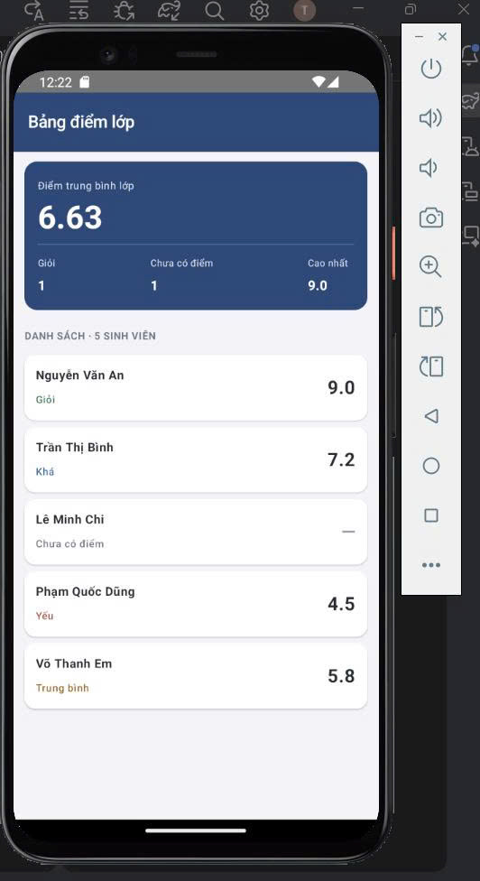

# Source Code – Bài tập 3: Tổng hợp for + if + nullable - Tuần 2
## 1. Tổng quan chương trình
Chương trình xây dựng ứng dụng Android hiển thị bảng điểm lớp gồm 5 sinh viên. Mỗi sinh viên có họ tên và điểm số, trong đó có một sinh viên chưa có điểm.
Chương trình thực hiện các chức năng:

- Hiển thị danh sách sinh viên.
- Phân loại học lực dựa trên điểm số.
- Hiển thị trạng thái "Chưa có điểm" đối với giá trị `null`.
- Tính điểm trung bình của các sinh viên đã có điểm.
- Đếm số sinh viên Giỏi và số sinh viên chưa có điểm.
- Tìm điểm cao nhất trong danh sách.

File mã nguồn chính là `MainActivity.kt`.
## 2. Khai báo lớp Student
```kotlin
data class Student(
    val name: String,
    val score: Double?
)
```
### Trong đó
- `data class Student`: khai báo lớp dữ liệu dùng để lưu thông tin sinh viên.
- `name: String`: lưu họ tên sinh viên, không cho phép nhận giá trị `null`.
- `score: Double?`: lưu điểm số, cho phép nhận một giá trị số thực hoặc `null`.
- `val`: khai báo thuộc tính chỉ đọc sau khi đối tượng được khởi tạo.

Dấu `?` trong `Double?` thể hiện rằng điểm số có thể chưa tồn tại. Đây là cơ sở để xử lý trường hợp sinh viên chưa có điểm mà không cần sử dụng một giá trị số giả để thay thế.

## 3. Khởi tạo danh sách sinh viên
```kotlin
val students = listOf(
    Student("Nguyễn Văn An", 9.0),
    Student("Trần Thị Bình", 7.2),
    Student("Lê Minh Chi", null),
    Student("Phạm Quốc Dũng", 4.5),
    Student("Võ Thanh Em", 5.8)
)
```
Danh sách có 5 sinh viên với các trường hợp:
- Nguyễn Văn An: 9.0 điểm.
- Trần Thị Bình: 7.2 điểm.
- Lê Minh Chi: chưa có điểm (`null`).
- Phạm Quốc Dũng: 4.5 điểm.
- Võ Thanh Em: 5.8 điểm.

Dữ liệu được khai báo sẵn trong code để phục vụ việc kiểm thử chương trình.
## 4. Hàm phân loại học lực
```kotlin
fun xepLoaiHocLuc(score: Double): String {
    return if (score < 0 || score > 10) {
        "Không hợp lệ"
    } else if (score >= 8.0) {
        "Giỏi"
    } else if (score >= 6.5) {
        "Khá"
    } else if (score >= 5.0) {
        "Trung bình"
    } else {
        "Yếu"
    }
}
```
Hàm nhận điểm số kiểu `Double` và trả về tên xếp loại kiểu `String`.
Các điều kiện được kiểm tra lần lượt:
1. Điểm nhỏ hơn 0 hoặc lớn hơn 10: Không hợp lệ.
2. Điểm từ 8.0 trở lên: Giỏi.
3. Điểm từ 6.5 trở lên: Khá.
4. Điểm từ 5.0 trở lên: Trung bình.
5. Các trường hợp còn lại: Yếu.

Hàm này được tái sử dụng từ Bài tập 2. Trước khi gọi hàm, chương trình cần kiểm tra `score` khác `null`, vì hàm chỉ nhận một giá trị `Double` hợp lệ.

## 5. Tính toán thống kê bằng for và if
```kotlin
var totalScore = 0.0
var studentWithScore = 0
var excellentCount = 0
var missingScoreCount = 0
var highestScore = 0.0

for (student in students) {
    if (student.score == null) {
        missingScoreCount++
    } else {
        val score = student.score

        totalScore += score
        studentWithScore++

        if (score >= 8.0 && score <= 10.0) {
            excellentCount++
        }

        if (score > highestScore) {
            highestScore = score
        }
    }
}
```
### Ý nghĩa các biến

| Biến | Chức năng |
|---|---|
| `totalScore` | Tổng điểm của các sinh viên đã có điểm. |
| `studentWithScore` | Số sinh viên đã có điểm. |
| `excellentCount` | Số sinh viên đạt mức Giỏi. |
| `missingScoreCount` | Số sinh viên chưa có điểm. |
| `highestScore` | Điểm cao nhất trong danh sách đã có điểm. |

### Cách thức hoạt động
- Vòng lặp `for` duyệt qua từng sinh viên.
- Nếu `student.score == null`, tăng `missingScoreCount` lên 1.
- Nếu đã có điểm, cộng điểm vào `totalScore` và tăng `studentWithScore`.
- Nếu điểm từ 8.0 đến 10.0, tăng `excellentCount`.
- Nếu điểm lớn hơn `highestScore`, cập nhật điểm cao nhất.
Nhờ điều kiện `if / else`, sinh viên chưa có điểm không được cộng vào tổng điểm hoặc số lượng sinh viên đã có điểm.
## 6. Tính điểm trung bình lớp
```kotlin
val averageScore = if (studentWithScore > 0) {
    totalScore / studentWithScore
} else {
    0.0
}
```
Điểm trung bình được tính bằng tổng điểm chia cho số sinh viên đã có điểm.
Điều kiện `studentWithScore > 0` giúp tránh phép chia cho 0 khi danh sách không có sinh viên nào có điểm.
Với dữ liệu mẫu:
- Tổng điểm: 9.0 + 7.2 + 4.5 + 5.8 = 26.5.
- Số sinh viên đã có điểm: 4.
- Điểm trung bình: 26.5 / 4 = 6.625.

Khi hiển thị với hai chữ số thập phân, kết quả là **6.63**.
## 7. Hiển thị trạng thái nullable
```kotlin
val result = if (score == null) {
    "Chưa có điểm"
} else {
    xepLoaiHocLuc(score)
}
```
Đoạn code kiểm tra xem sinh viên đã có điểm hay chưa.
- Nếu `score == null`, hiển thị "Chưa có điểm".
- Nếu có điểm, gọi hàm `xepLoaiHocLuc()` để phân loại.
Điểm số được hiển thị bằng toán tử an toàn nullable:
```kotlin
score?.let {
    String.format(java.util.Locale.US, "%.1f", it)
} ?: "—"
```
Nếu có điểm, chương trình định dạng điểm với một chữ số thập phân. Nếu chưa có điểm, giao diện hiển thị dấu gạch ngang.
## 8. Hiển thị giao diện bằng Jetpack Compose
| Thành phần | Chức năng |
|---|---|
| `Scaffold` | Tạo bố cục chính của màn hình. |
| `TopAppBar` | Hiển thị tiêu đề "Bảng điểm lớp". |
| `Column` | Sắp xếp các thành phần theo chiều dọc. |
| `Row` | Sắp xếp các chỉ số thống kê theo chiều ngang. |
| `Card` | Tạo thẻ thống kê và thẻ sinh viên. |
| `Text` | Hiển thị tên, điểm số và kết quả xếp loại. |
| `Spacer` | Tạo khoảng cách giữa các thành phần. |
| `Modifier.background()` | Thiết lập màu nền cho thành phần giao diện. |

Hàm `ThongKeItem()` hiển thị từng chỉ số thống kê. Hàm `StudentScoreCard()` hiển thị thông tin của một sinh viên, giúp mã nguồn được chia thành các phần rõ ràng và dễ tái sử dụng.
## 9. Kết quả kiểm thử
| Sinh viên | Điểm | Kết quả |
|---|---:|---|
| Nguyễn Văn An | 9.0 | Giỏi |
| Trần Thị Bình | 7.2 | Khá |
| Lê Minh Chi | — | Chưa có điểm |
| Phạm Quốc Dũng | 4.5 | Yếu |
| Võ Thanh Em | 5.8 | Trung bình |

Các chỉ số thống kê mong đợi:
- Tổng số sinh viên: 5.
- Số sinh viên đã có điểm: 4.
- Điểm trung bình: 6.63.
- Số sinh viên Giỏi: 1.
- Số sinh viên chưa có điểm: 1.
- Điểm cao nhất: 9.0.
## 10. Ảnh chụp kết quả

## 11. Bài học
Bài tập giúp em củng cố kiến thức về lớp dữ liệu, kiểu nullable `Double?`, vòng lặp `for`, cấu trúc điều kiện `if / else` và cách xây dựng hàm xử lý dữ liệu.
Thông qua bài tập, em biết cách xử lý dữ liệu bị thiếu, loại trừ giá trị chưa có điểm khỏi phép tính trung bình, thống kê kết quả học tập và hiển thị thông tin bằng Jetpack Compose.