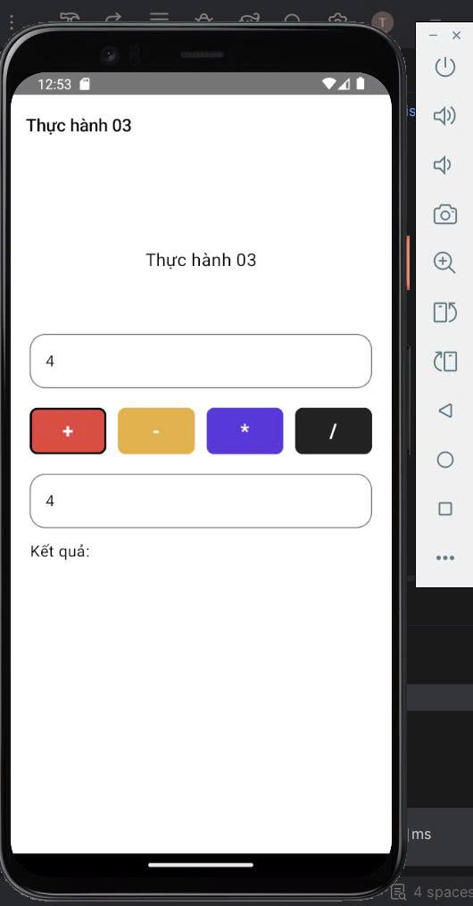
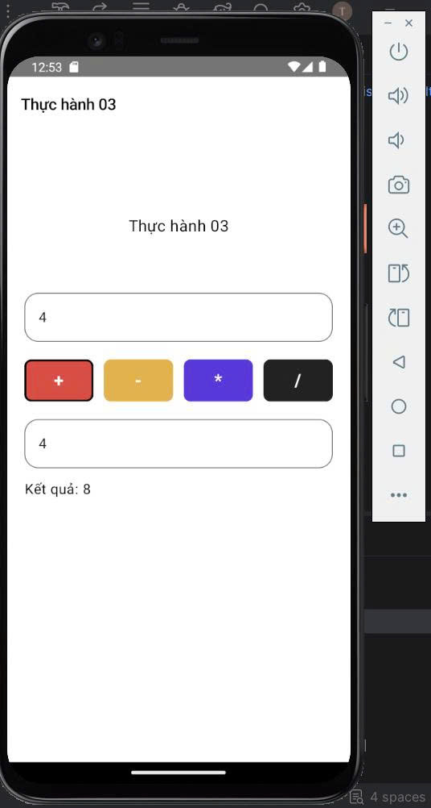

# Source Code – Bài tập 4: Máy tính cơ bản - Tuần 2
## 1. Tổng quan chương trình
Chương trình xây dựng ứng dụng Android thực hiện các phép toán cơ bản trên hai số do người dùng nhập vào.
Ứng dụng có giao diện gồm hai ô nhập số, bốn nút phép toán cộng, trừ, nhân, chia và khu vực hiển thị kết quả. Khi người dùng nhấn một nút phép toán, chương trình kiểm tra dữ liệu đầu vào, thực hiện tính toán và hiển thị kết quả tương ứng.
Chương trình thực hiện các chức năng:
- Nhập số thứ nhất và số thứ hai.
- Thực hiện phép cộng, trừ, nhân và chia.
- Hiển thị kết quả tính toán trên giao diện.
- Đánh dấu phép toán đang được chọn bằng viền đen.
- Kiểm tra dữ liệu nhập không hợp lệ.
- Xử lý trường hợp chia cho 0.
- Quản lý trạng thái giao diện bằng `remember` và `mutableStateOf`.

File mã nguồn chính là `MainActivity.kt`.

## 2. Khai báo các biến trạng thái
```kotlin
var soThuNhat by remember { mutableStateOf("4") }
var soThuHai by remember { mutableStateOf("4") }
var ketQua by remember { mutableStateOf<String?>(null) }
var phepToanDuocChon by remember { mutableStateOf("+") }
var thongBaoLoi by remember { mutableStateOf("") }
```
### Trong đó
- `soThuNhat`: lưu giá trị được nhập ở ô số thứ nhất.
- `soThuHai`: lưu giá trị được nhập ở ô số thứ hai.
- `ketQua`: lưu kết quả tính toán dưới dạng chuỗi hoặc `null` khi chưa có kết quả.
- `phepToanDuocChon`: lưu ký hiệu phép toán hiện tại.
- `thongBaoLoi`: lưu nội dung thông báo lỗi nếu dữ liệu không hợp lệ.

`remember` kết hợp với `mutableStateOf` giúp Jetpack Compose ghi nhớ trạng thái trong quá trình giao diện hoạt động.
Khi giá trị trạng thái thay đổi, giao diện liên quan sẽ được cập nhật tự động.
Hai ô nhập được khởi tạo với giá trị `4`, vì vậy khi mở ứng dụng, người dùng có thể thử ngay các phép toán mà không cần nhập dữ liệu trước.
## 3. Nhập và kiểm tra dữ liệu
```kotlin
OutlinedTextField(
    value = soThuNhat,
    onValueChange = {
        soThuNhat = it
        ketQua = null
        thongBaoLoi = ""
    },
    modifier = Modifier.fillMaxWidth(),
    singleLine = true,
    keyboardOptions = KeyboardOptions(
        keyboardType = KeyboardType.Decimal
    )
)
```
Đoạn code trên tạo ô nhập số thứ nhất. Ô nhập số thứ hai được xây dựng tương tự và sử dụng biến `soThuHai`.

### Ý nghĩa các thành phần
- `OutlinedTextField`: tạo ô nhập dữ liệu có đường viền.
- `value`: xác định nội dung đang hiển thị trong ô nhập.
- `onValueChange`: nhận giá trị mới khi người dùng nhập hoặc xóa dữ liệu.
- `singleLine = true`: giới hạn ô nhập trên một dòng.
- `KeyboardType.Decimal`: đề xuất bàn phím số có hỗ trợ nhập số thập phân.
- `Modifier.fillMaxWidth()`: cho ô nhập chiếm chiều rộng tối đa có thể.

Khi người dùng thay đổi dữ liệu, chương trình xóa kết quả cũ và thông báo lỗi cũ để tránh hiển thị kết quả của phép tính trước đó.
### Chuyển đổi dữ liệu nhập
```kotlin
val a = soThuNhat.trim().toDoubleOrNull()
val b = soThuHai.trim().toDoubleOrNull()
```
Hai ô nhập nhận dữ liệu dưới dạng `String`. Vì vậy, chương trình cần chuyển dữ liệu thành số thực trước khi tính toán.

- `trim()`: loại bỏ khoảng trắng ở đầu và cuối chuỗi.
- `toDoubleOrNull()`: chuyển chuỗi thành `Double` nếu hợp lệ; ngược lại trả về `null`.

Việc sử dụng `toDoubleOrNull()` giúp chương trình kiểm tra dữ liệu mà không làm ứng dụng gặp lỗi khi người dùng nhập chuỗi không phải số.
## 4. Hàm thực hiện phép tính
```kotlin
fun tinhToan(phepToan: String) {
    val a = soThuNhat.trim().toDoubleOrNull()
    val b = soThuHai.trim().toDoubleOrNull()
    phepToanDuocChon = phepToan
    if (a == null || b == null) {
        ketQua = null
        thongBaoLoi = "Vui lòng nhập hai số hợp lệ."
        return
    }
    if (phepToan == "/" && b == 0.0) {
        ketQua = null
        thongBaoLoi = "Không thể chia cho 0."
        return
    }

    val ketQuaTinh = when (phepToan) {
        "+" -> a + b
        "-" -> a - b
        "*" -> a * b
        "/" -> a / b
        else -> return
    }
    ketQua = ketQuaTinh.toString()
    thongBaoLoi = ""
}
```
Hàm `tinhToan()` nhận vào ký hiệu phép toán và thực hiện phép tính tương ứng.
### Cách thức hoạt động
1. Chuyển hai giá trị nhập thành số thực.
2. Lưu phép toán đang được chọn.
3. Kiểm tra hai giá trị có hợp lệ hay không.
4. Kiểm tra số chia có bằng `0` khi thực hiện phép chia hay không.
5. Sử dụng `when` để lựa chọn phép tính.
6. Chuyển kết quả thành chuỗi để hiển thị trên giao diện.
7. Xóa thông báo lỗi khi phép tính thành công.
### Các phép toán
| Ký hiệu | Phép toán | Biểu thức |
|---|---|---|
| `+` | Cộng | `a + b` |
| `-` | Trừ | `a - b` |
| `*` | Nhân | `a * b` |
| `/` | Chia | `a / b` |

Biểu thức `when` giúp chương trình lựa chọn một trong các phép tính dựa trên ký hiệu nhận được.
Điều kiện `if` được sử dụng để kiểm tra dữ liệu và xử lý những trường hợp đặc biệt trước khi thực hiện phép toán.
## 5. Xử lý dữ liệu không hợp lệ và chia cho 0
### Kiểm tra dữ liệu đầu vào
```kotlin
if (a == null || b == null) {
    ketQua = null
    thongBaoLoi = "Vui lòng nhập hai số hợp lệ."
    return
}
```
Nếu một trong hai giá trị không thể chuyển thành số, chương trình sẽ hiển thị thông báo yêu cầu người dùng nhập lại.
Toán tử `||` có nghĩa là OR (hoặc). Điều kiện đúng nếu ít nhất một trong hai giá trị bằng `null`.
Lệnh `return` kết thúc hàm ngay tại đó, không cho chương trình tiếp tục thực hiện phép tính.
### Kiểm tra phép chia cho 0
```kotlin
if (phepToan == "/" && b == 0.0) {
    ketQua = null
    thongBaoLoi = "Không thể chia cho 0."
    return
}
```
Trong đó:
- `phepToan == "/"`: kiểm tra phép toán đang thực hiện có phải phép chia hay không.
- `b == 0.0`: kiểm tra số thứ hai có bằng 0 hay không.
- `&&`: toán tử AND (và), yêu cầu cả hai điều kiện đều đúng.

Nếu người dùng chọn phép chia và nhập số thứ hai bằng 0, ứng dụng không thực hiện phép tính mà hiển thị thông báo lỗi.
### Kiểm tra kết quả không hữu hạn
```kotlin
if (!ketQuaTinh.isFinite()) {
    ketQua = null
    thongBaoLoi = "Kết quả vượt giới hạn tính toán."
    return
}
```
`isFinite()` kiểm tra kết quả có phải số hữu hạn hay không. Dấu `!` mang ý nghĩa phủ định.
Điều kiện này giúp xử lý trường hợp kết quả không hữu hạn trước khi đưa kết quả lên giao diện.
## 6. Định dạng kết quả
```kotlin
fun dinhDangKetQua(value: String): String {
    val number = value.toDoubleOrNull() ?: return ""

    return if (number.isFinite() && number % 1.0 == 0.0) {
        number.toLong().toString()
    } else {
        number.toString()
    }
}
```
Hàm định dạng kết quả giúp hiển thị số nguyên gọn hơn.
Ví dụ:

| Giá trị tính toán | Kết quả hiển thị |
|---|---|
| `8.0` | `8` |
| `0.0` | `0` |
| `16.0` | `16` |
| `1.0` | `1` |
| `1.5` | `1.5` |

### Trong đó:
- `toDoubleOrNull()`: chuyển chuỗi kết quả thành số thực.
- `?:`: trả về chuỗi rỗng nếu không chuyển đổi được.
- `number % 1.0 == 0.0`: kiểm tra phần thập phân có bằng 0 hay không.
- `toLong()`: chuyển số nguyên sang kiểu số nguyên dài.
- `toString()`: chuyển giá trị thành chuỗi để hiển thị.

Nhờ đó, kết quả không xuất hiện phần `.0` không cần thiết khi kết quả là số nguyên.
## 7. Hiển thị kết quả và quản lý trạng thái
```kotlin
Text(
    text = if (ketQua != null) {
        "Kết quả: ${dinhDangKetQua(ketQua)}"
    } else {
        "Kết quả:"
    },
    fontSize = 16.sp,
    color = Color.Black
)
```
Sử dụng `Text` để hiển thị kết quả tính toán.
- Nếu `ketQua` khác `null`, chương trình định dạng và hiển thị kết quả.
- Nếu chưa có kết quả hoặc phép tính không thành công, giao diện chỉ hiển thị `Kết quả:`.

Thông báo lỗi được hiển thị riêng khi `thongBaoLoi` không rỗng:
```kotlin
if (thongBaoLoi.isNotEmpty()) {
    Text(
        text = thongBaoLoi,
        color = Color(0xFFD32F2F),
        fontSize = 13.sp
    )
}
```
Khi người dùng thay đổi dữ liệu nhập, kết quả và thông báo lỗi được xóa. Khi người dùng nhấn một nút phép toán, chương trình thực hiện kiểm tra và cập nhật lại trạng thái.
## 8. Xây dựng giao diện bằng Jetpack Compose

| Thành phần | Chức năng |
|---|---|
| `Scaffold` | Tạo bố cục tổng thể của màn hình. |
| `TopAppBar` | Hiển thị thanh tiêu đề. |
| `Column` | Sắp xếp các thành phần theo chiều dọc. |
| `Row` | Sắp xếp bốn nút phép toán theo chiều ngang. |
| `OutlinedTextField` | Tạo hai ô nhập số. |
| `Button` | Tạo nút thực hiện phép toán. |
| `Text` | Hiển thị tiêu đề, kết quả và thông báo lỗi. |
| `Spacer` | Tạo khoảng cách giữa các thành phần. |
| `Modifier.fillMaxWidth()` | Mở rộng thành phần theo chiều ngang. |
| `Modifier.weight(1f)` | Chia đều chiều rộng cho bốn nút trong `Row`. |
| `Modifier.border()` | Tạo viền đen cho nút đang được chọn. |

### Hàm `NutPhepToan()`
Hàm `NutPhepToan()` được xây dựng riêng để tạo các nút phép toán.
Hàm nhận các tham số:
- `kyHieu`: ký hiệu phép toán.
- `mauNen`: màu nền của nút.
- `dangChon`: xác định nút có đang được chọn hay không.
- `modifier`: cho phép tùy chỉnh kích thước và bố cục.
- `onClick`: xử lý sự kiện khi người dùng nhấn nút.

Việc tách hàm giúp tránh lặp lại code khi tạo bốn nút có cấu trúc giống nhau. Bốn nút được thiết lập màu sắc riêng biệt và có chiều rộng bằng nhau nhờ `Modifier.weight(1f)` trong phạm vi `Row`.
## 9. Kết quả kiểm thử
Với dữ liệu đầu vào ban đầu gồm số thứ nhất bằng `4` và số thứ hai bằng `4`, kết quả mong đợi:

| Số thứ nhất | Phép toán | Số thứ hai | Kết quả |
|---:|:---:|---:|---:|
| 4 | `+` | 4 | 8 |
| 4 | `-` | 4 | 0 |
| 4 | `*` | 4 | 16 |
| 4 | `/` | 4 | 1 |

## 10. Ảnh chụp kết quả


## 11. Bài học
Qua bài tập, em thực hành cách xây dựng giao diện Android bằng Jetpack Compose, nhận dữ liệu từ `OutlinedTextField`, quản lý trạng thái bằng `remember` và `mutableStateOf`, xử lý sự kiện nhấn nút và sử dụng biểu thức `when` để thực hiện các phép toán.
Bài tập cũng giúp em hiểu cách kiểm tra dữ liệu nhập bằng `toDoubleOrNull()`, sử dụng cấu trúc điều kiện `if`, xử lý trường hợp chia cho 0 và cập nhật kết quả trên giao diện theo trạng thái của ứng dụng.